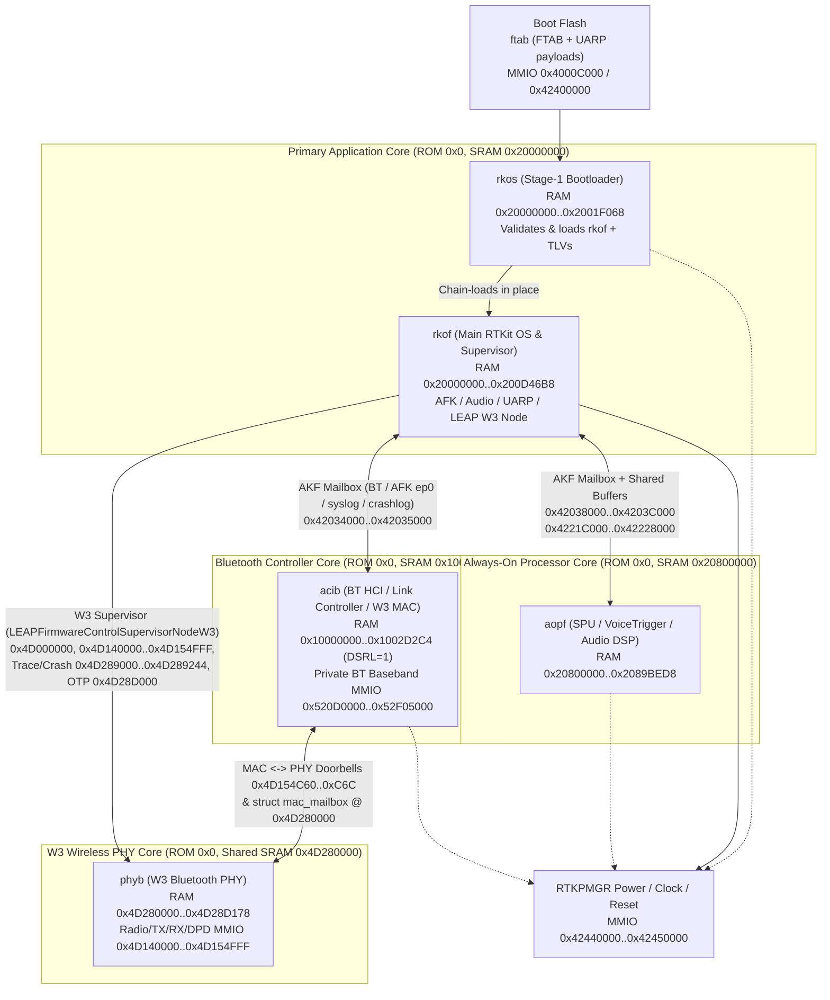

# Apple T2016 (`b515d` / Laguna) Multi-Firmware Architecture & IPC Map

This document maps the cross-firmware architecture, RTKit image wire format, CPU/FPU profiles, memory layout, boot chain, and hardware MMIO / shared-SRAM IPC topology across all five RTKit firmware images extracted from the UARP `ftab` container (`../{phyb,rkos,rkof,aopf,acib}`), and describes how the gradual C11 reconstruction suite in `phyb_re/` is organized.

---

## 1. Bundle Provenance & `ftab` Image Inventory

The parent `ftab_dump/` directory comes from an Apple UARP accessory firmware bundle (`Firmware.acsw`) targeting **Apple Silicon `T2016` Revision B0** (`chip_revision_b0`, `SOC_ = 0x00002016`, `SOCR = 0`), board configuration **`b515d`** (`AirPods3,6` / `laguna` wireless audio earbuds platform).

- **Bundle version (`../bver`, 66 B)**: `90.3431000025000000.6807|date:2026 8 17|updv:348|chip_revision_b0` (`SHA-256: e3db0509732a26f923545542de4b8810363bc96c9b32ff1b2977a158b89b015d`).
- **Five ARMv7E-M RTKit firmware images** reconstructed in this repository:

| Tag | Subsystem Role | Raw Size | Raw SHA-256 | Product / Subsystem Banner (`0xCC` ptr) | RTKit Runtime (`0xC8` ptr) | Reconstruction Path |
|---|---|---:|---|---|---|---|
| **`phyb`** | W3 Bluetooth / Wireless PHY Coprocessor (`WxBtPhy/firmware/w3`) | `74,240 B` (`0x12200`) | `15f3ce1c30b82e3f87c45974284ccfa68e10928fea0f09a1a46376ac04cd50d4` | `185{T:w3}{C:B0}.debug` | `RTKit_debug-3514.0.15.debug` | Root (`src/`, `include/btp/`, `link/phyb.ld`) |
| **`rkos`** | Stage-1 RTKit OS Boot & FTAB / IMG4 Loader | `134,176 B` (`0x20c20`) | `adf98c119724a5c6bec397f70fd08d65b3108c261cf0e6ad4b81ede766f18ecf` | `RTKitOSPlatform-3431.0.25~004286` | `RTKit_release-3514.0.15.release` | `targets/rkos/` |
| **`rkof`** | Main Application RTKit OS + Audio + AFK/UARP + W3 Supervisor | `2,159,008 B` (`0x20f1a0`) | `2b40a04f29ea859ba750fb954ebda9c2eefe1c3dcc7593d19115f55ad1edaa98` | `RTKitOSPlatform-3431.0.25~004286` (`RTKitAudioFirmware v600.499`, `AppleFirmwareKit-743.0.5.0.1`) | `RTKit_release-3514.0.15.release` | `targets/rkof/` |
| **`aopf`** | Always-On Processor (`b515daop` SPU + VoiceTrigger + Audio DSP) | `597,056 B` (`0x91c40`) | `8c9818d7ea1dbc6b99b634b5089300501e446ec2c4a79408818b00660741dfff` | `b515daop:MAIN:DEVELOPMENT:AppleSPUFirmwareBuilder-990.0.13~5644` | `RTKit_release-3514.0.15.release` | `targets/aopf/` |
| **`acib`** | Bluetooth Controller (`ACI` HCI + Link Controller + W3 MAC) | `1,066,208 B` (`0x1044e0`) | `dda0b224409bb5997dd95374312f13a207591e857edf9f2cff234ae86b66795e` | `3.91.1.0` | `RTKit_release-3514.0.15.release` | `targets/acib/` |

- **Companion non-RTKit `ftab` payloads** (referenced by `rkof` during peripheral bring-up, outside the 5 RTKit targets):
  - `../apmu` (`5,372 B`, `AccessoryPMUFirmware-38~4635.RELEASE`): tiny Cortex-M PMU microcontroller image linked at SRAM `0x20000000`.
  - `../btpw` (`2,823 B`) & `../rtpf` (`2,095,629 B`): power-table / runtime asset payloads consumed by the platform supervisor.

---

## 2. Shared RTKit `3514.0.15` Lineage & Binary Wire Format

All five targets are built atop the exact same RTKit generation (**`RTKit-3514.0.15`**, compiled as `.debug` in `phyb` and `.release` in `rkos`, `rkof`, `aopf`, and `acib`) and share identical low-level image framing:

### 2.1 Vector Table (`0x00..0xBF`) & `uuid` v5 Header (`0xC0..0x107`)

Every image begins at VMA `0x00000000` with a 48-entry (`0xC0`-byte) ARMv7-M exception/IRQ vector table (`16` architectural vectors + `32` external IRQ lines), immediately followed at `0xC0..0x107` by a `0x48`-byte RTKit `uuid` version-5 header:

```c
struct rtk_uuid_v5_header {          /* File/ROM offset 0xC0..0x107 */
    char     magic[4];               /* +0x00 (0xC0): "uuid" (0x64697575) */
    uint32_t version;                /* +0x04 (0xC4): 5 */
    uint32_t rtkit_build_vma;        /* +0x08 (0xC8): VMA of "RTKit_{debug,release}-3514.0.15..." */
    uint32_t product_build_vma;      /* +0x0C (0xCC): VMA of product/OS build banner string */
    uint8_t  image_uuid[16];         /* +0x10 (0xD0): 16-byte Mach-O LC_UUID identity */
    uint32_t reserved0[2];           /* +0x20 (0xE0): 0, 0 */
    uint32_t meta_tlv_vma;           /* +0x28 (0xE8): VMA of FourCC TLV metadata table */
    uint32_t meta_tlv_size;          /* +0x2C (0xEC): Exact byte size of TLV metadata table */
    uint32_t text_or_img_end;        /* +0x30 (0xF0): 4B-aligned __TEXT end (or fwsg off in rkos) */
    uint32_t reserved1[3];           /* +0x34 (0xF4): 0, 0, 0 */
    uint32_t rtkit_build_vma_dup;    /* +0x40 (0x100): Duplicate of rtkit_build_vma */
    uint32_t product_build_vma_dup;  /* +0x44 (0x104): Duplicate of product_build_vma */
};
```

| Target | `SP_init` (`vec[0]`) | `Reset` (`vec[1]`) | `NMI` (`vec[2]`) | `HardFault` (`vec[3]`) | `SVCall`/`PendSV` | `SysTick` (`vec[15]`) | `image_uuid` (`0xD0..0xDF`) |
|---|---|---|---|---|---|---|---|
| **`phyb`** | `0x00000000` | `0x00000201` | `0x00000205` | `0x00000205` | `0x00000209` | `0x00000435` | `5fa9e1613a11373e968af4be63f54183` |
| **`rkos`** | `0x00000000` | `0x00000109` | `0x000002e1` | `0x00000291` | `0x00000375` | `0x000034d9` | `3216699061473171a396018473417533` |
| **`rkof`** | `0x00000000` | `0x000001f9` | `0x000002e1` | `0x00000291` | `0x00000375` | `0x00016f71` | `ff8569c1ff1f31fd9dc524a5c9791ecf` |
| **`aopf`** | `0x00000000` | `0x0000693d` | `0x00006a25` | `0x000069d5` | `0x00006ab9` | `0x0004e519` | `61724c3e01443e9088827a4a637bd44a` |
| **`acib`** | `0x1001bd80` | `0x00000109` | `0x000e4a95` | `0x000e4a51` | `0x000e4b15` | `0x000e58f1` | `e8ded9ecb94430a39c801069bd1d094b` |

*(Note: `phyb`, `rkos`, `rkof`, and `aopf` store `0` in boot `vec[0]` and initialize `MSP`/`PSP` explicitly inside `Reset_Handler` before painting stacks with `"RTKSTACK"` (`0x4B434154534B5452`), setting `R7 = 0x77777700`, and switching `SCB->VTOR` to their larger runtime vector tables — e.g. `rkos` at `0x13200`, `rkof` at `0x1BFA00`, and `aopf` with runtime `VTOR[0] = 0x2089BA10`; `acib` provides `0x1001bd80` in boot `vec[0]` as hardware initial `MSP` and switches `SCB->VTOR` to `0x400`.)*

### 2.2 Universal `fwsg` v1 Segment Trailer (`EOF - 0x60 .. EOF`)

Every raw binary in `ftab_dump/` ends with an identical `0x60`-byte **`fwsg` version-1** segment directory used by the `ftab`/RTKit loader to map `__TEXT` and `__DATA`:

```c
struct fwsg_segment_desc {           /* 32 bytes each, starting at table_off = EOF - 0x60 */
    uint64_t vmaddr;                 /* Target runtime VMA */
    uint32_t fileoff;                /* Source byte offset in raw ftab payload */
    uint32_t filesize;               /* Initialized payload bytes in file */
    uint32_t vmsize;                 /* Total mapped VMA span (filesize + zero-filled BSS) */
    uint32_t flags;                  /* 0x4 for __TEXT, 0x0 for __DATA */
    char     segname[8];             /* "__TEXT\0\0" or "__DATA\0\0" */
};

struct fwsg_trailer {                /* 32 bytes at EOF - 0x20 */
    char     magic[4];               /* "fwsg" */
    uint32_t version;                /* 1 */
    uint32_t table_off;              /* File offset of fwsg_segment_desc[0] (= EOF - 0x60) */
    uint32_t seg_count;              /* 2 (__TEXT and __DATA) */
    uint8_t  zero_pad[16];           /* All zeros */
};
```

| Target | `__TEXT` VMA (`fileoff=0`) | IDB `ROM_TEXT` / `ROM_RODATA` Split | `__DATA` VMA (`RAM_BASE`) | `__DATA` `fileoff` | `__DATA` `filesize` (Init) | `__DATA` `vmsize` (Init+BSS) | `RAM_END` (`RTSZ`) | `table_off` |
|---|---|---|---|---|---|---|---|---|
| **`phyb`** | `0x00000000..0x000088d2` | `0xc0..0x6b48` / `0x6b48..0x88d2` | `0x4d280000` | `0x0088e0` | `0x0098bd` (39,101 B) | `0x00d178` (53,624 B) | `0x4d28d178` | `0x0121a0` |
| **`rkos`** | `0x00000000..0x00017590` | `0xc0..0x13090` / `0x13090..0x17590` | `0x20000000` | `0x020000` | `0x000ba4` (2,980 B) | `0x01f068` (127,080 B) | `0x2001f068` | `0x020bc0` |
| **`rkof`** | `0x00000000..0x001f389a` | `0xc0..0x1bfa00` / `0x1bfa00..0x1f389a` | `0x20000000` | `0x200000` | `0x00f138` (61,752 B) | `0x0d46b8` (870,072 B) | `0x200d46b8` | `0x20f140` |
| **`aopf`** | `0x00000000..0x00077b14` | `0xc0..0x64000` / `0x64000..0x77b14` | `0x20800000` | `0x077b20` | `0x01a0b0` (106,672 B) | `0x09bed8` (638,680 B) | `0x2089bed8` | `0x091be0` |
| **`acib`** | `0x00000000..0x000f984c` | `0xc0..0xefea8` / `0xefea8..0xf984c` | `0x10000000` | `0x0f9860` | `0x00ac1e` (44,062 B) | `0x02d2c4` (185,028 B) | `0x1002d2c4` | `0x104480` |

### 2.3 FourCC Metadata TLV Records (`meta_tlv_vma`)

In all five images, `[meta_tlv_vma, meta_tlv_vma + meta_tlv_size)` decodes with zero trailing remainder into packed `(uint32_t tag_le, uint32_t length, uint8_t value[length])` records:

- **Universal runtime invariants**:
  - `STKG(4) = 0x00000AFF` (`__stack_chk_guard` initial value across all 5 images)
  - `RTSZ(4) = RAM_END` (`__DATA.vmaddr + __DATA.vmsize`)
  - `TXSZ(4) = align4(__TEXT.filesize)` (`0x88d4`, `0x17590`, `0x1f389c`, `0x77b14`, `0xf984c`)
  - `RRST(4) = 0`, `RRED(4) = 0`, `SLID(8) = 0`
- **Placement difference (`.debug` vs `.release`)**:
  - `phyb` (`RTKit_debug`) places `meta_tlv_vma` at the end of initialized `__DATA` (`0x4d289844`, `0x79` B).
  - `rkos` (`0x16400`, `0x17a` B), `rkof` (`0x1e1ac0`, `0x1da` B), `aopf` (`0x739bc`, `0x132` B), and `acib` (`0xf9640`, `0x116` B) place `meta_tlv_vma` inside `ROM_RODATA` (`__TEXT`), where the stage loader patches personalization/boot tags (`SOC_=0x2016`, `SOCR=0`, `PRNG(32)`, `ECID(8)`, `NONC(8)`, `TUNS(8)`, `TUNZ(4)`, `RTTO(8)`) in RAM-backed code space prior to core release.
- **Data Segment Reload (`DSRL`) & Warm-Resume Semantics**:
  - `phyb`, `rkos`, `rkof`, `aopf`: `DSRL(1) = 0` — the external host/stage loader copies `__DATA` from `fwsg[1].fileoff` into SRAM before releasing reset (`phyb`'s `Reset_Handler` still implements the conditional `DSRL == 1` self-copy path from `0x88D2`; `rkos` `Reset_Main` checks `*0x20000190` for RTKit warm-resume sentinels `0xBAADF1AC` / `0xCAFE4B0B` before jumping via `*0x20000194`).
  - `acib`: `DSRL(1) = 1` (with `ASRS(8)` / `ASRD(8)` reload descriptors) and checks the same RTKit warm-resume sentinel `*(uint32_t *)0x100016E4 == 0xCAFE4B0B` during deep-sleep retention wakeups.

---

## 3. CPU, ISA & Floating-Point Configuration Matrix

Full Capstone Thumb-2 instruction decoding across all **32,407** IDA-recovered functions confirms that every target is **ARMv7E-M (`-target armv7em-none-eabi -mcpu=cortex-m4`)** little-endian Thumb-2 with **zero** double-precision (`.f64`) and **zero** ARMv8-M / FPv5 instructions:

| Target | IDB Functions | Thumb-2 Core | VFP Single-Precision (`.f32`) | Half-Precision (`f16` conv) | Compiler Flags (`ARM_CFLAGS`) | Language / Toolchain Notes |
|---|---:|---|---:|---:|---|---|
| **`phyb`** | `232` *(219 in `phyb.c` + 13 2–4B IRQ/nop stubs)* | Cortex-M4 (`ARMv7E-M`) | `20` insns (`vmov`/`vmla`/`vcvt`) | `0` | `-mcpu=cortex-m4 -mfloat-abi=hard -mfpu=fpv4-sp-d16 -Oz` | C11, Apple Clang `-Oz` with machine outliner (`OUTLINED_FUNCTION_0..29`) |
| **`rkos`** | `864` | Cortex-M4F (`ARMv7E-M`) | `0` arithmetic `.f32` ops; `11` FP context insns (`vstm`/`vldm` `s0..s31`, `vmrs`/`vmsr fpscr`) at `0x2B6..0x526`, `CPACR` CP10/CP11 enabled in `Reset_Main` (`0x1F8`) | `0` | `-mcpu=cortex-m4 -mfloat-abi=hard -mfpu=fpv4-sp-d16 -Oz` | C RTKit stage-1 boot / FTAB + IMG4/DER + SHA-256/384 verification, MPU, `0x200`-byte trampoline to `0x01000000` |
| **`rkof`** | `17,479` | Cortex-M4F (`ARMv7E-M`) | `1,088` insns | `0` | `-mcpu=cortex-m4 -mfloat-abi=hard -mfpu=fpv4-sp-d16 -Oz` | C + C++ (`AppleFirmwareKit`, `IOAudio2`, `UARP`, `RTKitAudioFirmware`, `W3` supervisor) |
| **`aopf`** | `3,915` | Cortex-M4F (`ARMv7E-M`) | `5,147` insns | `171` (`vcvtb.f32.f16`) | `-mcpu=cortex-m4 -mfloat-abi=hard -mfpu=fpv4-sp-d16 -Oz` | C++ (`AppleSPUFirmware`, `AppleAOPAudioFirmware`, `VoiceTriggerWxV2`, `m4fcc` DSP) + C |
| **`acib`** | `9,917` | Cortex-M4 (`ARMv7E-M`) | `0` real VFP (`CPACR` untouched; soft IEEE-754 helpers at `0xE50B8..0xE564B`) | `0` | `-mcpu=cortex-m4 -mfloat-abi=soft -Oz` | C Bluetooth Controller stack (HCI, Link Manager, Baseband LC, W3 MAC driver, 7 MPU regions, `ARM_DWT` profiler) |

---

## 4. Boot Topology, Shared SRAM & Cross-Core MMIO / IPC Map



### 4.1 Primary Core Sequential Handoff (`rkos` → `rkof`)

`rkos` and `rkof` execute **sequentially on the same primary Cortex-M4F processor** (`ROM = 0x00000000`, `SRAM = 0x20000000`):
1. **`rkos`** boots out of reset (`0x109`), enables the FPU (`CPACR`), configures the ARMv7-M SCS/MPU (`0xE000E000`, 121 xrefs), drives the `0x4000C000` peripheral (33 xrefs) and `RTKPMGR` (`0x4244607C`), parses the FTAB and verifies IMG4/DER + SHA-256/384, records 6 remap descriptors at `0x200004C8` plus `BMID` (`0x44494D42`, v`0x20251121`) and `CLHE` v3.3 crashlog headers in the `0x20020000` window, copies a `0x200`-byte trampoline (`0x20000988..0x20000B88`) to `0x01000000`, and launches **`rkof`** into the same `0x00000000` / `0x20000000` execution map (warm-boot resume vector at `0x20000190`/`0x20000194`).
2. **`rkof`** initializes the full RTKit OS platform (`RTKitOSPlatform-3431.0.25~004286`), brings up companion cores (`aopf`, `acib`, `phyb`, and `apmu`) via `RTKPMGR` (`0x42440000`), establishes Apple Firmware Kit (`AFK`) / Kingfisher (`AKF`) endpoint mailboxes, runs the main audio pipeline (`RTKitAudioFirmware v600.499`), and supervises Bluetooth & W3 PHY lifecycle (`LEAPFirmwareControlSupervisorNodeW3`).

### 4.2 Cross-Firmware Hardware Aperture & Shared-Memory Matrix

Addresses below are verified directly against literal-pool loads and IDA segment cross-references across all five `.i64` databases:

| Physical Aperture | Hardware Block / Shared Window | `phyb` | `rkos` | `rkof` | `aopf` | `acib` | Functional Role & Cross-Core Protocol |
|---|---|---|---|---|---|---|---|
| `0x40007000..0x4000CFFF` | Boot Peripherals (UART / SPI / Timer) | — | R/W (`0x40007000`: 2, `0x4000C000`: 33 xrefs) | R/W | — | — | Shared by `rkos` and `rkof` on the primary AP core (`0x40008000` is an IDB segment in `rkos` with 0 xrefs) |
| `0x4002C000..0x4002FFFF` | Audio / Sensor Shared Peripheral | — | — | R/W | R/W | — | Shared peripheral block between `rkof` and `aopf` |
| `0x42019000`, `0x4201C000` | SoC Fabric / Interrupt Router | — | — | R/W | R/W | — | Shared interrupt / fabric control between `rkof` and `aopf` |
| **`0x42034000..0x42035000`** | **AKF Mailbox A (AP ↔ BT)** | — | — | **R/W** | — | **R/W** | **Kingfisher RTKit IPC mailbox** linking `rkof` (host supervisor) and `acib` (BT controller): carries RTKit `ep0` management, `syslog`, `crashlog`, and AFK HCI/snoop channels |
| **`0x42038000..0x4203C000`** | **AKF Mailbox B (AP ↔ AOP)** | — | — | **R/W** | **R/W** | — | **Kingfisher RTKit IPC mailbox** (`MailboxSharedMemoryEndpoint`) linking `rkof` and `aopf` (`ep0`, VoiceTrigger, SPU sensor/audio streams) |
| `0x42201000..0x42201FFF` | Platform Misc / Strap Regs | — | seg only (0 xrefs) | R/W | — | — | Mapped in the `rkos` IDB but only referenced by `rkof` code |
| `0x4221C000..0x42228000` | AOP Shared Audio / DMA Apertures | — | — | R/W | R/W | — | Multi-channel shared audio/DMA control apertures between `rkof` and `aopf` |
| `0x42400000..0x4240FFFF` | Boot Flash / NV Controller | — | seg only (0 xrefs) | R/W | — | — | `ftab` storage interface referenced by `rkof` (UARP update); segment present but unreferenced in `rkos` |
| **`0x42440000..0x42450000`** | **`RTKPMGR` (SoC Power & Clock Mgr)** | — | **R/W** | **R/W** | **R/W** | **R/W** | Central SoC clock/reset/power-domain controller accessed by 4 of 5 firmwares (`acib` polls `0x42440418`/`0x42440420`; `rkof` manages `0x42440000..0x4244D000`) |
| `0x4D000000..0x4D000FFF` | W3 Subsystem Wrapper / Reset | — | — | R/W | — | — | Accessed by `rkof` (`rtkit_early_platform_init` at `+0x800`) to release/gate the W3 PHY wrapper |
| `0x4D140000..0x4D153FFF` | W3 Radio, TX, DPD & RX Digital | R/W | — | R/W | — | — | Primary W3 modem/RF banks (`phyb` `regs_radio.h`, `regs_tx.h`, `regs_dpd.h`, `regs_rx.h`); also inspected/initialized by `rkof` (`sub_FDD90`) |
| **`0x4D154000..0x4D154FFF`** | **W3 Sequencer, Clocks & IPC Doorbells** | **R/W** | — | **R/W** | — | **R/W** | **3-way W3 control & MAC↔PHY hardware doorbells** (detailed in §4.3 below) |
| **`0x4D280000..0x4D280FFF`** | **W3 Shared SRAM: `mac_mailbox`** | **R/W** | — | **R/W** | — | **R/W** | **3-way shared SRAM mailbox** (`phyb` `__DATA` base): command `+0x000`, Dekker lock `+0x0C0`/`+0x0C2`, TXPWR table `+0x0C4`, FRS `+0x1E4`, response `+0x400`, FRS RSSI `+0x4C0`, crash copy `+0x5C1..+0x5D4` |
| **`0x4D281000..0x4D28D177`** | **W3 PHY SRAM (`NVV`, `status`, `trace`, `.bss`)** | **R/W** | — | **R/W** | — | — | `NVV_MDMI_BASE` (`0x4D281000`, `0x4000` B), `TXPWR_TABLE_MARKER` (`0x4D284000`), `PHY_STATUS_BASE` (`0x4D285000`), `TRACE_RING_BASE` (`0x4D289000`, `0x200` B) & `CRASH_RECORD_BASE` (`0x4D289200`, `0x4C` B) harvested by `rkof` (`sub_FDC38`/`sub_FDCB4`) |
| `0x4D28D000..0x4D294000` | W3 Upper Shared SRAM / OTP Window | — | — | R/W | — | — | Provisioned by `rkof` (`bt_phy_otp_init`) immediately above `phyb`'s `RAM_END` (`0x4D28D178`) |
| `0x520D0000..0x52F05000` | BT Baseband / Link Controller MMIO | — | — | — | — | R/W | Private Bluetooth hardware blocks (`0x520E4000`, `0x52200000`, `0x52400000`, `0x52800000`, `0x52F04000`) driven exclusively by `acib` |
| `0xE0000000..0xE000EFFF` | ARMv7-M SCS (`NVIC`, `SCB`, `SysTick`, `MPU`, `FPU`, `DWT`) | R/W | R/W | R/W | R/W | R/W | Core-local ARM System Control Space (`acib` additionally uses `DWT` `0xE0001000` cycle/watchpoint counters) |

### 4.3 Three-Way W3 PHY / MAC / Supervisor Protocol (`phyb` ↔ `acib` ↔ `rkof`)

Cross-referencing `phyb` (`include/btp/shared.h`, `include/btp/regs_seq.h`, `src/w3/mac.c`, `src/w3/frs.c`), `acib` (`sub_7C820`, `sub_7CABC`, `sub_7CB20`, `sub_7CB4C`, `sub_7CD5C`, `sub_7D35C`, `sub_7D9D4`, `sub_84EB8`), and `rkof` (`LEAPFirmwareControlSupervisorNodeW3`, `bt_phy_otp_init`, `sub_FDC38`, `sub_FDCB4`, `sub_FDD90`) establishes the exact byte-level contract across `0x4D154000` MMIO and `0x4D280000` SRAM:

| Shared Interface | Address / Offset | `phyb` (W3 PHY) Peer | `acib` (BT MAC) Peer | `rkof` (AP Supervisor) Peer |
|---|---|---|---|---|
| **MAC→PHY Doorbell / Status / Ack** | `0x4D154C68` (`IPC_STATUS`) & `0x4D154C6C` (`IPC_ACK`) | Reads `0x4D154C68` in MAC IRQ (`BIT(15)` cmd, `BIT(2)` coex, `BIT(0)` FRS); acks `0x4D154C6C` | `sub_7CB20` / `sub_7CB4C` writes `0x8000` (`BIT(15)`) to `0x4D154C68` after staging request | — |
| **PHY→MAC Doorbell / Status+W1C** | `0x4D154C60` (`IPC_DOORBELL`) & `0x4D154C64` (`ACI_SHARED_4D154C64`) | Writes `0x4D154C60`: `BIT(15)` resp, `BIT(2)` FRS done, `BIT(1)` warm-boot ack, `BIT(0)` crash | `sub_7CABC` polls `BIT(15)` on `0x4D154C64` & writes `0x8000` W1C; `sub_7CD5C` handles `BIT(0)` crash, `BIT(1)`, `BIT(2)` | — |
| **Mailbox Request & Response** | `0x4D280000` (`req`) & `0x4D280400` (`resp`) | Dispatches `req.command` (`+0x002`), sets `resp.flags = 0x0080` (`MAC_RESPONSE_READY`) at `0x4D280400` | `sub_7C820` sets `dword_1002268C = 0x4D280000`, `dword_10022690 = 0x4D280400`; `sub_7CB20` writes `req.command` (`+0x002`) | Maps `0x4D280000` during W3 bring-up / supervision |
| **Dekker Spinlock & Full TXPWR Table** | `0x4D2800C0` (`flag_mac`), `0x4D2800C2` (`flag_phy`), `0x4D2800C4` (`0x120` B) | Contends on `uint16_t` Dekker flags at `+0x0C0`/`+0x0C2` before reading full 8-band TX power table (`+0x0C4`) | `sub_84EB8` sets `u16[0x60]=1` (`+0x0C0`), spins on `u16[0x61]` (`+0x0C2`), copies `0x120` B from `0x10021EA9` to `+0x0C4`, clears `u16[0x60]=0` | — |
| **Fast RSSI Scan (`FRS`)** | `0x4D2801E4..0x1FC`, `0x4D2804C0`, `0x4D2805C0`, `0x4D2805FE` & `0x4D154038` | Reads band/gain/`channel_bitmap[16]` at `+0x1E4`, scans via `SEQ_RF_CTRL` (`0x4D154038`), writes `frs_rssi[128]` (`+0x4C0`) & `frs_gain[126]` (`+0x5FE`) | `sub_7D35C` / `sub_7D9D4` writes band (`+0x1E4`) & 16B channel bitmap (`+0x1E6`), drives `0x4D154038`, harvests RSSI/status | — |
| **Crash Descriptor & Trace Ring** | `0x4D2805C1..0x5D4` (20 B), `0x4D289000` (`trace_ring`), `0x4D289200` (`crash_record`) | `w3/exception.c` writes `crash_record` (`0x4D289200`), copies 20B unaligned summary to `0x4D2805C1`, rings `BIT(0)` | `sub_7CD5C` catches `BIT(0)` on `0x4D154C64` and reads unaligned 20B crash summary `0x4D2805C1..0x4D2805D4` | `sub_FDC38` / `sub_FDCB4` reads `trace_ring` (`0x4D289000`) & `crash_record` (`0x4D289200..0x4D289244`) |
| **Wrapper, Unlock & OTP `'NV'` Synthesis** | `0x4D000800`, `0x4D154048` (`SEQ_REG_UNLOCK`), `0x4D281000`, `0x4D28D000..0x4D291FFF` | Consumes `NVV_MDMI_BASE` (`0x4D281000`) & unlocked sequencer/modem banks (`0x4D140000..0x4D154FFF`) | Touches `0x4D154C00` clock control during MAC/PHY sync | Snapshots GTB (`0x4D000800`), toggles `0x4D154048`/`0x4D140000`, `bt_phy_otp_init` (`0xFD7C0`) synthesizes `'NV'` (`0x4E56`) container into `0x4D28D000` & warm-restore table at `0x4D291008` |

---

## 5. Multi-Target Reconstruction Tree Organization

The repository preserves the complete, hash-archived `phyb` reconstruction at the workspace root while hosting self-contained, recompileable freestanding C11 + host test + ARM differential verification trees for the four companion `ftab` targets under `targets/`. `phyb` keeps its source at the root (it predates the multi-target layout) but its documentation is under `targets/phyb/`:

```text
phyb_re/
├── FIRMWARE_MAP.md              # Cross-firmware architecture, wire format & IPC reference (this file)
├── Makefile                     # Root phyb rules + delegated multi-target phony rules
├── include/btp/ & src/ & link/  # Root phyb C11 reconstruction & linker script
├── tests/ & tools/              # Root phyb host tests, differential harnesses & verify_all_targets.py
├── verification/                # Pinned phyb archive manifest, ledger & historical fixtures
└── targets/
    ├── phyb/                    # phyb documentation (source stays at the workspace root)
    ├── rkos/                    # Stage-1 RTKit OS bootloader reconstruction (../../../rkos)
    ├── rkof/                    # Main RTKit OS + Audio + AFK/UARP + W3 supervisor (../../../rkof)
    ├── aopf/                    # Always-On Processor SPU/Audio/VoiceTrigger firmware (../../../aopf)
    └── acib/                    # Bluetooth Controller HCI/LC/MAC firmware (../../../acib)
```

Each `targets/<name>/` tree mirrors the root architecture:
- **`link/<name>.ld` & `include/<name>/memmap.h`**: Exact `ROM_VECTORS`, `ROM_TEXT`, `ROM_RODATA`, `RAM_DATA`, and `RAM_BSS` layout derived from the raw binary's `fwsg` trailer and IDA segment map. (`phyb` keeps `link/phyb.ld` and `include/btp/` at the root.)
- **`src/`**: Freestanding C11 (`clang -target armv7em-none-eabi`, `-Werror`, zero Hex-Rays decompiler idioms) with `@provenance RVA 0x... <symbol>` tags on every reconstructed function, paired with binary-backed `ROM_RODATA` / `RAM_DATA` and explicit isolation of pending/retained native bodies.
- **`verification/inventory.json` & `verification/ledger.json`**: 100% function-by-function accounting against the `.i64` database (`reconstructed_c`, `retained_native`, `pending_c`). Root `phyb` uses the hash-bound `verification/ledger.json` and `verification/input_manifest.json` instead of a per-target inventory.
- **`tests/` & `tools/`**:
  - `make -C targets/<name> all` — builds ARMv7E-M `<name>.elf` and native host test runner (for `phyb`, run root `make arm host`).
  - `make -C targets/<name> check` — compile-time `layout.c` struct/offset proof + host behavioral tests (for `phyb`, root `make check`).
  - `make -C targets/<name> verify` — `verify_layout.py` + `verify_fidelity.py` anti-idiom & provenance audit (for `phyb`, root `make verify`).
  - `make -C targets/<name> verify-semantics` — `verify_load_image.py` (`ROM_VECTORS` / `ROM_RODATA` / `RAM_DATA` byte-match vs `../../../<name>`) + Unicorn/Capstone differential ARM execution against the raw firmware binary (for `phyb`, root `make verify-semantics`).

### Unified Build & Audit Commands

```sh
# Verify root phyb (including SHA-256 archive consistency)
make all check verify verify-archive

# Build and verify individual or all sub-targets (outputs under $(BUILD)/<target>)
make rkos aopf acib rkof
make targets-all
make targets-check
make targets-verify
make targets-semantics

# Run unified 5-firmware audit and emit build/multi-target-summary.json
make verify-all
# or directly:
python3 tools/verify_all_targets.py --build build --output build/multi-target-summary.json
```

---

## 6. Verification & Reconstruction Ledger Summary

All five `ftab` targets pass build, layout, anti-idiom (`0` banned Hex-Rays tokens across `64` reconstructed C files), `PT_LOAD` / binary-backed load-image byte verification, and the unified audit via `tools/verify_all_targets.py` (`build/multi-target-summary.json`). `phyb`'s semantic gate still reports the documented ROM-observability divergences below:

| Target | Raw SHA-256 Verified | IDB Functions | `reconstructed_c` | `retained_native` / Helpers | `pending_c` | Host & Layout Checks | Load-Image & Differential Verification |
|---|---|---:|---:|---:|---:|---|---|
| **`phyb`** | Yes (`15f3ce1c...`) | `232` *(219 in `phyb.c`)* | `189` *(197 w/ helpers)* | `30` helpers (`38` debt sites) | `0` | `73/73` host checks, `22` state blocks, `verify-archive` green | `28/28` ELF sections (`74,127 B`) + `7,558 B` `ROM_RODATA` exact; `124,801` archived differential cases (`64` documented ROM-observability divergences) |
| **`rkos`** | Yes (`adf98c11...`) | `864` | `103` | `0` | `761` | `78/78` host checks, `6` entries + `10` state blocks | `4/4` regions (`20,908 B`) exact; `528` Unicorn Cortex-M4F cases (`521` matched on `103/103` `reconstructed_c` w/ `0` divergences + `7` documented shim cases; `0` stub survivors) |
| **`aopf`** | Yes (`8c9818d7...`) | `3,915` | `91` | `0` | `3,824` | Structural & behavioral suite, `60` `SHF_ALLOC` sections (`0` floating `.bss`) | `57/57` `PT_LOAD` slices + `4/4` binary-backed (`187,596 B`) exact; `214/214` Unicorn Cortex-M4F MMIO R+W / `udf`-trapped cases (`0` divergences, `91/91` 3-stub mutations killed) |
| **`acib`** | Yes (`dda0b224...`) | `9,917` | `120` | `1` (`NMI_Handler`, `128 B` exact) | `9,796` | `128/128` host checks, `12` sections & `35` pinned VMAs (`unpinned_bss=0`) | `12/12` `PT_LOAD` sections + `6/6` binary-backed (`84,362 B`) exact; `200/200` Unicorn Cortex-M4 cases across `120/120` `reconstructed_c` (`0` divergences, `0/357` stub survivors) |
| **`rkof`** | Yes (`2b40a04f...`) | `17,479` | `108` | `5` veneers (`442 B` exact) | `17,366` | `123/123` host checks, `8` sections + `23` `STATE_*` blocks + `6` handler VMAs | `8/8` `PT_LOAD` sections + `4/4` slices + `5/5` veneers (`275,092 B`) exact; `175/175` Unicorn Cortex-M4F cases across `108/108` `reconstructed_c` (`0` divergences, `3/3` stubs defeated) |
| **Total** | **5 / 5 (`100%`)** | **`32,407`** | **`611`** | **`6` veneers + `30` helpers (`38` sites)** | **`31,747`** | **5 / 5 PASS (`-Werror`, `0` anti-idioms)** | **`125,918` total differential cases (`1,117` live sub-target Unicorn cases w/ `0` `reconstructed_c` divergences)** |
